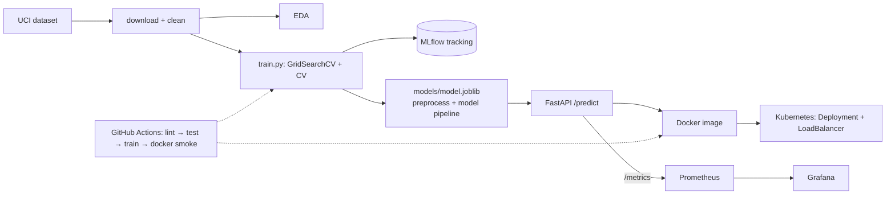

# Heart Disease Risk Prediction – End-to-End MLOps

Classifier for heart-disease risk (UCI Heart Disease, Cleveland subset) with experiment tracking,
CI/CD, containerisation, Kubernetes deployment and Prometheus/Grafana monitoring.

## Architecture



## Repository layout

| Path | Purpose |
|---|---|
| `src/config.py` | Paths, schema, constants |
| `src/data_processing.py` | Download, clean, preprocessing transformer |
| `src/eda.py` | EDA figures → `reports/figures/` |
| `src/train.py` | Tuning, CV, MLflow logging, model packaging |
| `src/predict.py` | CLI inference |
| `src/api.py` | FastAPI app (`/predict`, `/health`, `/metrics`) |
| `tests/` | Pytest unit tests (offline, synthetic data) |
| `.github/workflows/ci.yml` | Lint → test → train → Docker smoke test |
| `Dockerfile`, `docker-compose.yml` | Serving image; API + Prometheus + Grafana |
| `k8s/` | Deployment, Service (LoadBalancer), Ingress, HPA |
| `monitoring/` | Prometheus config, Grafana datasource + dashboard |

## Setup (clean machine)

```bash
python -m venv .venv && source .venv/bin/activate     # Windows: .venv\Scripts\activate
pip install -r requirements-dev.txt
python scripts/download_data.py      # downloads raw data, writes data/processed/heart_clean.csv
```
Manual alternative: download `processed.cleveland.data` from
<https://archive.ics.uci.edu/dataset/45/heart+disease>, add the header from `src/config.py::RAW_COLUMNS`,
save as `data/raw/heart_raw.csv`, then clean it with `python -c "from src.data_processing import *; ensure_clean_data()"`.

## Run the pipeline

```bash
make eda        # figures in reports/figures
make train      # trains LR / RF / GB, logs to ./mlruns, writes models/model.joblib + metrics.json
mlflow ui --backend-store-uri ./mlruns      # http://127.0.0.1:5000
make lint && make test
python -m src.predict --json sample_input.json
```

## Serve

```bash
make serve                                   # local, http://localhost:8000/docs
curl -X POST localhost:8000/predict -H "Content-Type: application/json" -d @sample_input.json
```
Example response:
```json
{"prediction":1,"label":"heart disease likely","confidence":0.87,"probability_disease":0.87,"request_id":"3fa9c1d2"}
```

## Docker

```bash
make train && ./scripts/smoke_test.sh        # build, run, call /health + /predict + /metrics
```

## Kubernetes (Minikube / Docker Desktop)

```bash
# Minikube: make the local image visible to the cluster
minikube start
minikube image load heart-disease-api:latest
kubectl apply -f k8s/deployment.yaml -f k8s/service.yaml
kubectl get pods,svc
minikube tunnel                              # separate terminal; gives the LoadBalancer an EXTERNAL-IP
curl http://<EXTERNAL-IP>/health
# optional: kubectl apply -f k8s/ingress.yaml (after `minikube addons enable ingress`) and k8s/hpa.yaml
```
Cloud (GKE/EKS/AKS): push the image to a registry, change `image:` in `k8s/deployment.yaml`, apply the same manifests.

## Monitoring

```bash
docker compose up --build
# API http://localhost:8000 · Prometheus http://localhost:9090 · Grafana http://localhost:3000 (admin/admin)
```
Dashboard "Heart Disease API" is auto-provisioned (request rate, p95 latency, predictions per class, 5xx rate).
Generate traffic: `for i in $(seq 50); do curl -s -XPOST localhost:8000/predict -H 'Content-Type: application/json' -d @sample_input.json >/dev/null; done`.
Request logs (JSON lines) go to stdout and `logs/api.log`.

## Design notes (use these in your report – and personalise them)
- Missing values (`ca`, `thal`) are imputed *inside* the pipeline → no leakage across CV folds.
- Preprocessing + model are one sklearn `Pipeline`, so serving applies identical transforms.
- Model selected on cross-validated ROC-AUC, not on the test set; test set reported once.
- Recall matters clinically (missed disease is costlier than a false alarm) – compare models on it too.
